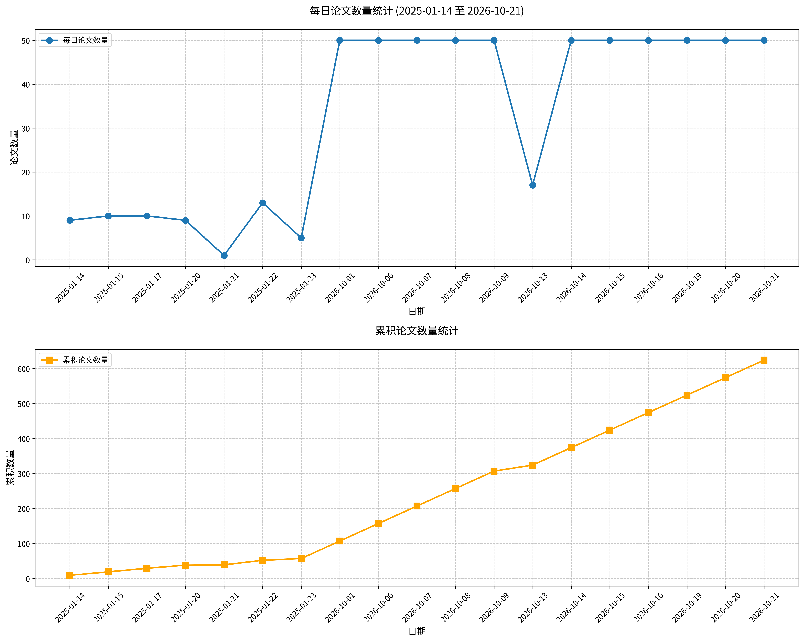

#  Hugging Face 2026-10-21 论文日报

## 📊 今日论文统计
- 总论文数：50
- 热门领域：RL, LLM, GPT, Transformer

## 📝 论文详情

### 1. Matrix-Game 4.0：利用视频模型构建实时可玩游戏世界

**原文标题：** Matrix-Game 4.0: Harnessing Video Models for Real-Time Playable Game Worlds

**摘要：**
从可控视频迈向真正可玩的世界，需要持久的世界状态、可执行的游戏规则以及低延迟交互。我们提出了下一代 Matrix-Game 的路线图：通过可执行游戏运行框架将游戏执行与视觉生成分离，并介绍了基于该设计构建的首个系统 Matrix-Game 4.0。轻量级游戏引擎维护世界状态并执行交互规则；多模态编码智能体将玩家想法转化为游戏代码和动态场景描述；基于自回归视频模型的渲染器以动态场景描述和记忆参考为条件，将引擎渲染的低多边形代理转化为精细视觉画面。该框架为视觉生成提供持续指导，并支持以自然语言创建和修改场景与玩法。我们的渲染器在对齐的低多边形与高保真视频对上进行训练，并蒸馏为因果生成器，以四帧为块、通过一到两步去噪进行生成。结合针对性的推理优化，Matrix-Game 4.0 可在单块 NVIDIA RTX5090 上实现 480p、60 FPS 的游戏体验，按键到显示延迟为 112ms。单步生成可达到 83FPS 的稳态吞吐量，峰值 GPU 内存占用为 18.2GiB。在固定提示词下，稳态吞吐量在 RTX5080 上也可达到 67FPS，在 RTX5070Ti 上达到 58FPS。我们展示了具有引擎强制执行机制的可定制射击游戏和驾驶游戏，并发布代码、模型权重和低多边形游戏资产，以支持可玩游戏世界的研究与创作。

**论文链接：** [HuggingFace](https://huggingface.co/papers/2610.27999) | [arXiv](https://arxiv.org/abs/2610.27999)

---

### 2. PAR：用于状态跟踪中长度泛化的进度对齐循环

**原文标题：** PAR: Progress-Aligned Recurrence for Length Generalization in State Tracking

**摘要：**
循环语言模型可在测试时运行更多迭代，但额外迭代未必有助于其解决更长的问题。对于序列状态跟踪，最终答案监督并未规定每次迭代应推进多远，而重复更新可能改变循环状态的尺度。我们提出进度对齐循环（PAR），其训练第 k 次迭代的预测以匹配前 k 个操作后的状态，并将循环状态重新缩放到其第一次迭代的范数。在 swap-S_5 上，最多在 32 步上训练的 Qwen2.5-0.5B 模型在 512 步时达到 95.5% 的平均全状态准确率，即训练长度的 16 倍；相比之下，同一骨干模型上 RLT 报告为 55.7%，显式思维链为 0.8%。受控 S_5 消融表明，移除范数锚定会将外推因子从 16 倍降至 2.2 倍以下，而将进度对齐目标替换为最终答案监督则至多降至 8 倍。一个学习到的完成读出器可在未提供停止深度时选择何时作答。当中间标签不可用时，前缀自蒸馏仅使用最终答案从较短问题前缀中诱导出对应关系。这些增益适用于各种序列状态跟踪任务，确立了深度外推所需的任务结构。这些发现支持同时训练中间预测和状态尺度，从而使额外的循环深度对更长问题有用。

**论文链接：** [HuggingFace](https://huggingface.co/papers/2610.27628) | [arXiv](https://arxiv.org/abs/2610.27628)

---

### 3. 聚焦式全模态GUI智能体

**原文标题：** Focused Omni-Modal GUI Agents

**摘要：**
图形用户界面（GUI）智能体日益基于流式全模态观测执行动作，这些观测涵盖截图、音频、视频、交互历史和设备状态。然而，在每一步均以相同方式暴露完整上下文忽视了相关性具有瞬态性与稀疏性：决定某一动作的信号在下一步可能成为干扰信息。由于已执行动作会反馈到上下文中，这些错误会累积为序列分心（Sequential Distraction），使智能体陷入不可逆的轨迹漂移。我们将这一底层需求表述为聚焦感知（Focused Perception）：一种逐步自适应、动作充分且非侵入式的表示。我们在FocusGUI中实现了这一点，这是一种轻量级适配器，能够针对特定步骤的决策参考动态地对多模态通道进行优先级排序。它并非统一处理所有输入，而是将最相关的证据压缩为紧凑的潜在表示，并以细微方式将其注入冻结解码器的嵌入中，在不改变其原生参数空间的情况下引导模型注意力。FocusGUI仅依靠动作监督进行训练，既不需要模态相关性标签，也不需要主干网络微调。在四个全模态主干模型上，与冻结主干模型相比，它平均将总体Type Match提升33.2，并将Exact Match提升至3.0倍；相较最强的现有增强方法，Type Match提升30.1。

**论文链接：** [HuggingFace](https://huggingface.co/papers/2610.26203) | [arXiv](https://arxiv.org/abs/2610.26203)

---

### 4. Ropedia W0：借助人类经验跨具身扩展移动-操作世界模型

**原文标题：** Ropedia W0: Scaling Loco-Manipulation World Models across Embodiments with Human Experience

**摘要：**
世界模型使具身智能体能够预测动作后果，然而，由于动作空间异构且多模态监督有限，跨多种具身形态联合建模移动与操作仍具挑战性。我们提出 Ropedia W0，这是首个覆盖人类与多样具身机器人的第一人称移动-操作世界基础模型。我们构建了 Xp-Data，包含 1 万小时的第一人称人类数据和 3 千小时的机器人数据，并配有统一的多模态标注与系统化质量控制。统一的运动学表示通过相机位姿编码移动，并通过投影骨架编码操作；其中机器人骨架将具身特定的正向运动学与大量人工关键点标注和校正相结合。我们还提出 Xp-Teleop，这是一个基于高质量灵巧人形机器人遥操作数据的长时程移动-操作基准。评估表明，该模型在五个跨具身基准（DreamDojo、Ψ_0、ω-HOME、Xp-Teleop 和 AgiBot）以及留出的人类第一人称视频上均达到最先进性能，涵盖从零样本推理到少样本及全数据后训练。扩大人类预训练数据规模可同时提升人类与机器人评估中的性能。经蒸馏后，我们的模型支持实时、长达数分钟的推演，从而实现实时 VR 交互。该模型在策略评估、基于模型的规划以及世界-动作建模中的应用，进一步证明了其在具身决策中的实用性。

**论文链接：** [HuggingFace](https://huggingface.co/papers/2610.26855) | [arXiv](https://arxiv.org/abs/2610.26855)

---

### 5. S-Agent 2.0：基于通用编码智能体的空间推理

**原文标题：** S-Agent 2.0: Spatial Reasoning with a General Coding Agent

**摘要：**
空间推理要求模型判断物体在三维空间中的位置、彼此之间的关系以及运动方式。近年来，智能体化视觉语言模型（VLM）通过使用三维感知工具主动收集证据，而非一次性作答，在此类任务上取得了显著提升。即便如此，在许多问题上，工具返回了正确证据，模型却仍未得出正确答案：模型与工具之间的鸿沟——即原始读数转化为可用结论的环节——仍未得到填补。我们提出 S-Agent 2.0，一种空间推理智能体，为现成的通用编码智能体配备命令行感知工具包，并围绕一个原则设计接口：帮助 VLM 闭合证据回路——获取场景证据、将其存入持久场景记忆，并以直白的空间语言解释每个读数。该设计保留了编码智能体的全部灵活性，且其处理的每个读数始终以工具的几何信息为依据。在 MMSI-Bench 和 ReVSI 上，该工具包使强开源模型 Qwen3.8-27B 相比不使用工具的同一智能体分别提升 +13.9 和 +20.5 分，使强闭源模型 Gemini-3.8-Flash 分别提升 +11.2 和 +9.6 分。在开放骨干模型上，S-Agent 2.0 在 MMSI-Bench 和 ReVSI 上分别达到 66.5 和 82.3，超过同一骨干上的专用系统 SpatialClaw（62.6 和 74.5）；搭配 Gemini-3.8-Flash 时，其达到 74.1 和 90.5，而后者为 67.0 和 79.7。两种工具带来的增益都会随着骨干模型能力增强而缩小，但 SpatialClaw 在 ReVSI 上的增益缩小幅度大得多，从 +13.2 降至 +2.7，而我们的方法仍保持在 +9.6。S-Agent 2.0 还可跨不同的通用编码智能体框架使用，例如 Codex 和 Claude Code。

**论文链接：** [HuggingFace](https://huggingface.co/papers/2610.28354) | [arXiv](https://arxiv.org/abs/2610.28354)

---

### 6. VLA-Rolling：更少的去噪步骤，通过自适应动作复用实现更优控制

**原文标题：** VLA-Rolling: Fewer Denoising Steps, Better Control via Adaptive Action Reuse

**摘要：**
流匹配视觉-语言-动作（VLA）模型通过迭代去噪高斯噪声来生成动作块，但通常仅执行一个较短的前缀，随后便基于更新后的观测重新规划。在这种滚动时域范式下，未执行的剩余部分——即动作尾部——会被丢弃，而下一个动作块则从新的噪声重新生成。我们表明，这一被丢弃的尾部保留了可迁移的去噪进展：动作尾部初始化能够以更少的去噪步骤达到或超越原生10步高斯基线的性能。然而，最优去噪预算在不同样本间差异显著，这表明尾部复用应当适应更新后的环境。基于这一观察，我们提出VLA-Rolling，一种轻量级推理框架，通过三个阶段复用动作尾部：动作尾部继承、逐动作置信度估计，以及通过重加噪与去噪预算分配实现的置信度引导精化，同时底层VLA保持冻结。在LIBERO、MetaWorld、LIBERO-Plus和RoboTwin 2.0上，跨π_{0.5}、SmolVLA、X-VLA和MolmoAct2，VLA-Rolling在全部16个模型—基准组合中降低了动作块推理成本，最高实现1.48倍加速，同时在14个组合中将成功率提升最高达15.08个百分点。这些结果表明，动作尾部并非仅仅是被丢弃的预测，而是可复用的中间状态，能够实现更高效、更准确的VLA推理。这些结果表明，动作尾部能够以更少的去噪步骤支持生成更优动作。项目地址：https://chenbao123ww.github.io/VLA-Rolling/。

**论文链接：** [HuggingFace](https://huggingface.co/papers/2610.25043) | [arXiv](https://arxiv.org/abs/2610.25043)

---

### 7. Sage-A1.5：从长时程执行到基于能力组合的科学探索

**原文标题：** Sage-A1.5: From Long-Horizon Execution to Scientific Exploration with Capability Composition

**摘要：**
在本报告中，我们介绍 Sage-A1.5，这是一个350亿参数的混合专家（Mixture-of-Experts）智能体模型。该模型在A1的基础上构建，通过自适应能力组合推进长时程问题求解。与A1相比，Sage-A1.5不仅学习解决单个任务，还学习组织工作并在执行过程中修正方法。Sage-A1.5突出三项改进：智能体编排、智能体验证和开放式科学发现。首先，智能体编排通过任务委派以及具有隔离上下文的子智能体之间的并行协作扩展单智能体执行能力，使复杂任务能够被分解并并发处理，在支持高效执行的同时减少并发子智能体之间的干扰。其次，智能体验证通过进度检查、证据验证和反思性策略修正增强长时程可靠性，使智能体能够识别无效搜索路径并采用替代方法。第三，开放式科学发现将智能体能力从回答预定义问题扩展到开展探索性研究，将科学探究与交互式分析和可检查的研究产物联系起来。我们通过复杂智能体任务和多学科科学应用展示这些能力。此外，我们希望 Sage-A1.5 为社区提供一个易于使用的开放式科学发现基础，提供一条从长时程任务执行到协作、可验证且可检查的科学探索的实用路径。

**论文链接：** [HuggingFace](https://huggingface.co/papers/2610.28578) | [arXiv](https://arxiv.org/abs/2610.28578)

---

### 8. CoEvo-RSI：当执行框架进化时，哪些模型应当跟随？

**原文标题：** CoEvo-RSI: When Harnesses Evolve, Which Models Should Follow?

**摘要：**
模型—执行框架协同进化已成为递归自我改进（RSI）智能体的一种重要范式，其执行支架与内在能力共同演化。我们研究了该范式中持续存在却常被忽视的“脑—体失配”问题，即不断演化的执行框架（体）要求模型（脑）表现出其尚未学会的行为，或限制其已具备的能力。我们提出CoEvo-RSI，一个通过智能体驱动的双向历史继承来推进模型—执行框架协同进化的RSI框架。借助共享的进化档案与执行反馈，一个元智能体协调执行框架从历史设计中的开发，以及模型检查点的选择或合并及随后在所选执行框架下的适配，从而使继承的能力与不断变化的执行需求对齐，以减少脑—体失配。CoEvo-RSI仅在其自身拒绝采样轨迹上使用监督微调（SFT），便使Qwen3.5-9B在多种垂直应用中与更大模型具有竞争力，包括多智能体故障归因、角色感知的文本到SQL以及智能家居指令遵循。它在TraceElephant上超过DeepSeek-V4-Pro（智能体准确率+14.16），在HomeBench VM上超过GLM-5.3（成功率+4.90），凸显了脑—体对齐的必要性以及双向历史继承在推进智能体协同进化方面的潜力。

**论文链接：** [HuggingFace](https://huggingface.co/papers/2610.25078) | [arXiv](https://arxiv.org/abs/2610.25078)

---

### 9. 通过点轨迹预测学习4D世界

**原文标题：** Learning the 4D World through Point Trajectory Forecasting

**摘要：**
可靠的多视角预测要求来自不同相机的视频能够描述同一个不断演化的三维场景。为此，我们提出视频-点模型（Video-Point Model, VPM），这是一种以多视角视频历史和语言指令为条件的世界模型，可联合预测任意视角的未来视频以及持续场景点的三维轨迹。我们通过相机条件化的多视角处理扩展预训练世界模型，以整合跨相机的互补观测，并加入轨迹头来预测物理点如何随时间运动。每条轨迹在所有视角中跟踪同一个点，因此在视频生成的同时监督这些轨迹，可将每个相机中的外观变化锚定到共享的三维运动描述上。为支持训练和评估，我们构建了VPM-Data，一个将同步多视角视频与持续点轨迹配对的仿真语料库，以及VP-WorldBench，一个涵盖仿真和真实环境的预测基准。我们进一步将机器人动作作为生成器中的一种token模态加入，从而将VPM扩展到机器人控制。动作token共享点监督主干网络，并与未来视频联合去噪，进而将策略建立在相同的三维感知表征上。在VP-WorldBench和现有4D生成基准上，与仅视频的对应模型相比，点监督同时提升了视频保真度和三维运动精度；在仿真和真实机器人实验中，它还提高了启用动作的模型的操作成功率。

**论文链接：** [HuggingFace](https://huggingface.co/papers/2610.28594) | [arXiv](https://arxiv.org/abs/2610.28594)

---

### 10. SolarRenderer：少步生成式参考渲染

**原文标题：** SolarRenderer: Few-Step Generative Reference Rendering

**摘要：**
游戏引擎和编码智能体可以指定场景的布局、运动和相机，但要将这种粗粒度结构转化为逼真视频，仍需要一个能够遵循该结构并补全其未指定外观的渲染器。现有渲染器与单一引擎的表示绑定，需要数十个去噪步骤或自身昂贵的蒸馏过程，并且从与其目标视频不对齐的条件中学习。我们提出 SolarRenderer，一种结构条件化视频渲染器，它通过两个轻量级 LoRA 对冻结的 MiniMax-H3 33B 骨干网络进行适配。结构视频按其描述帧的位置进入骨干网络的原生参考通路，不带类型标识符，仅以纯文本描述，从而使单个控制 LoRA 能够遵循任意结构表示。以预训练的四步 LoRA 为起点，结构引导的分布匹配可在四步内完成渲染，比 50 步采样快 12.3 倍，同时保持已学到的控制能力。一种块因果变体将相同设计扩展到流式处理，并实时渲染 768p 视频。为训练该模型，我们构建了一个帧对齐语料库，包含来自游戏引擎、模拟器和 YouTube 视频的 136K 个片段。在分布内测试集和包含 16 种结构表示的泛化基准上的实验表明，SolarRenderer 在两者上均取得当前最佳结果，并可泛化到 11 种未见过的表示，包括姿态骨架、草图和点云。

**论文链接：** [HuggingFace](https://huggingface.co/papers/2610.28630) | [arXiv](https://arxiv.org/abs/2610.28630)

---

### 11. 扩散模型的校正训练

**原文标题：** Correction Training for Diffusion Models

**摘要：**
扩散模型中的迭代采样可能因暴露偏差而导致误差累积。去噪器是在与噪声插值的真实图像上训练的，但在推理时，其输入由自身在前序步骤中产生的不完美预测构建而成，而这类输入在训练时从未见过。这可能是扩散模型在缺乏额外辅助（如 CFG）时常常表现不佳的原因之一。我们为扩散模型引入一个校正步骤，旨在缩小这种训练-推理差距。校正器以基础模型的预测为输入，并针对相同的真值目标进行训练。这使校正成为一个显式的学习任务，其训练输入由基础模型提供。在采样过程中，在每个去噪步骤，我们迭代地细化去噪器的干净样本预测。这使我们能够在中间去噪步骤校正预测，防止早期伪影残留到最终样本中。尽管校正器仅在基础去噪器的预测上训练，但在推理时可对其自身输出反复应用以获得更好的结果。这一简单框架在显著提升样本质量的同时基本保持多样性。我们在 DiT、SiT 和 JiT 上评估了我们的方法。我们的方法在无引导生成，尤其是无条件生成方面，显著改善了此前报告的 FID 分数；在无条件生成中，无引导地生成高质量样本一直尤为困难。我们的方法达到了与无分类器引导（CFG）相竞争的性能，并且将校正与 CFG 结合可进一步提升多样性并减少 CFG 典型的过度饱和。最后，我们表明，通过将精炼后的预测蒸馏回基础扩散模型，可以分摊校正带来的额外推理成本，在无需额外推理时开销的情况下保持质量增益。

**论文链接：** [HuggingFace](https://huggingface.co/papers/2610.14136) | [arXiv](https://arxiv.org/abs/2610.14136)

---

### 12. SWIFT：通过目标外推的自引导弱到强扩散模型

**原文标题：** SWIFT: Self-guided Weak-to-strong dIFfusion models via Target extrapolation

**摘要：**
训练高质量的扩散模型计算成本高昂，而推理时引导往往会进一步增加采样成本。在本工作中，我们引入了Swift，一种简单而有效的自引导训练方法，它使用一个冻结的弱去噪器来改进更强的模型，而不增加推理开销。对于每个噪声输入，Swift将干净回归目标从弱去噪器的预测中外推出去，放大那些仍然欠拟合的分量。弱引导可以是一个早期训练检查点，在主模型训练期间不需要反向传播，并且随后被丢弃。所得模型保留原始采样器，并支持条件和无条件生成，无需标签丢弃或无条件分支。我们通过对RKHS中有限时间群体梯度流的谱分析来解释这一机制。在早期停止的弱引导下，我们证明了非空范围的外推强度会产生严格低于匹配标准训练的后验均值误差，尽管将回归目标从后验均值移开。在CIFAR-10和ImageNet-256上的实验展示了在不同模型规模和表示下的改进。在一种ImageNet-256配置中，Swift使用大约一半的总训练计算量（包括引导准备和训练开销）超越了基线的最佳FID。在RAEv2上，它在无推理时引导的情况下达到FID 1.15，在有引导的情况下达到0.99。这些结果确立了目标外推作为一种有效的弱到强扩散训练方法，具有高效的单模型推理。

**论文链接：** [HuggingFace](https://huggingface.co/papers/2610.25844) | [arXiv](https://arxiv.org/abs/2610.25844)

---

### 13. MMEnterprise-Bench：面向演化中的多模态记录评估企业智能体

**原文标题：** MMEnterprise-Bench: Evaluating Enterprise Agents over Evolving Multimodal Records

**摘要：**
企业智能体需要基于通过团队协作不断演化的工作场所记录来回答问题。随着信息在文档、聊天记录和图表之间被共享、修正和修订，同一信息的多个版本会在工作空间中不断累积。因此，可靠的问答要求智能体能够基于充分证据进行推理、解决跨来源和时间冲突，并识别可用证据何时不足以确定答案。为系统评估这些能力，我们提出了MMEnterprise-Bench，这是一个包含1,613个问题的基准，问题基于模拟协作项目中不断演化的多模态记录构建，涵盖三类任务：证据推理、冲突解决和不可回答性。我们评估了10个专有和开源多模态大语言模型，发现即使是最强的模型，在证据包含跨来源或时间冲突，或跨越多个图像时，仍然表现困难。此外，增加检索预算或采用更大的检索器可以提高证据召回率，但并不能稳定转化为更高的答案准确率。这些发现凸显了基于演化中的工作场所记录进行推理所面临的持续挑战，并确立了MMEnterprise-Bench作为开发更可靠企业智能体的测试平台。代码和数据可在https://mlvlab.github.io/MMEnterprise-Bench/获取。

**论文链接：** [HuggingFace](https://huggingface.co/papers/2610.27911) | [arXiv](https://arxiv.org/abs/2610.27911)

---

### 14. LLM2R：从大语言模型到三维重装配器

**原文标题：** LLM2R: From Large Language Models to 3D Reassemblers

**摘要：**
三维部件装配旨在通过为每个部件预测一个刚性 SE(3) 变换，从一组未装配部件中重建完整形状。由于部件的放置位置很少由其自身几何形状决定，该任务需要对整个部件集合进行推理；而现有方法依赖成对关系或迭代生成与验证，难以扩展到包含大量部件的物体。我们提出 LLM2R，将部件装配转化为使用预训练仅解码器大语言模型（LLM）的序列建模：Point-BERT 编码器和 Q-Former 将每个部件压缩为一个几何 token 块，所有部件的块被拼接起来，一个通过低秩适配（LoRA）适配的因果 LLM 在一次前向传播中处理该序列。然而，因果注意力使一个部件的隐藏状态只能观察到位于其之前的部件。因此，LLM2R 在最后一个部件之后追加一个可学习的摘要 token 块：这些 token 位于每个部件之后，因此其状态以恒定的 token 开销聚合整个装配，而部件感知的姿态头在预测每个部件的旋转和平移之前，将该部件的状态与这些摘要 token 状态融合。由此，一种架构即可处理语义装配和几何装配，并在单次非自回归前向传播中预测所有姿态。LLM2R 在全部三个 PartNet 类别上取得最高的部件准确率和成功率，在 PartNeXt 上取得最优的旋转误差、平移误差和部件准确率，并在 Breaking Bad 上取得最低的平移误差和最快的推理速度；在该数据集上，只有一种专门面向断裂的方法更准确。其优势随着部件数量增加而扩大：在 100 个部件时，其在 Breaking Bad 上的部件准确率超过 GARF 33.5 个百分点，在 PartNet 上超过 Assembler 29.1 个百分点；并可零样本迁移到未见类别，其部件准确率比三个基线中最强者高 16 个点以上。

**论文链接：** [HuggingFace](https://huggingface.co/papers/2610.18604) | [arXiv](https://arxiv.org/abs/2610.18604)

---

### 15. Specter：通过量化使能的多步推测卸载实现快速MoE推理

**原文标题：** Specter: Fast MoE Inference via Quantization-Enabled Multi-Step Speculative Offloading

**摘要：**
混合专家（MoE）模型往往超出单个加速器的内存容量。将专家卸载到主机内存会造成严重的PCIe I/O瓶颈，因为数据相关的路由使传输始终处于关键路径上。我们提出Specter，一种利用量化将推测解码与专家卸载相结合的推理系统。其轻量级量化草稿模型可在设备上高效运行，同时保持高保真的专家激活模式。这为未来专家使用情况提供了准确的多步前瞻，使运行时能够在验证之前组织专家移动与执行，并提升通信与执行效率。在单请求推理下，Specter相较于最先进系统，在每输出词元时间（TPOT）上平均实现1.50倍（最高1.88倍）加速。Specter使内存受限的单GPU MoE推理在商用硬件上更加实用。我们的代码可在 https://github.com/wwwwwf/specter_asplos 获取。

**论文链接：** [HuggingFace](https://huggingface.co/papers/2511.14102) | [arXiv](https://arxiv.org/abs/2511.14102)

---

### 16. 绘画变化图作为生成绘画过程的指导

**原文标题：** Painting Change Map as guidance for generating painting processes

**摘要：**
数字艺术生成经历了巨大的范式转变，从静态图像合成转向能够模拟人类绘画过程的动态视频生成。尽管现有模型能够合成视觉上令人惊叹的绘画创作或“去绘画”过程的时间延时视频，但它们在很大程度上将创作过程视为黑箱。当前的条件机制要么过于刚性，依赖 Canny 边缘或深度图等静态几何线索；要么过于整体化，使用简单的标量进度变量，无法提供局部控制。因此，用户缺乏引导绘画随时间演化的能动性。在本研究中，我们认为，要对艺术作品的视频生成实现真正控制，需要联合理解两个基本维度：艺术家在何处行动，以及这些行动在何时发生。为实现这一目标，我们引入绘画变化图（Painting Change Map），这是一种新颖的时空控制机制，可在 1,000 个时间步构成的连续体上显式跟踪归一化结构变化；该分辨率足以捕捉细粒度的笔画级变化，同时保持计算可行性。通过将局部视觉差异映射到编码 RGB 空间，我们的表示能够为正向绘画和反向去绘画过程提供细粒度指导。广泛的基准测试证明了我们方法的有效性。我们优于现有的控制基线，并且与最先进的绘画方法相比取得了有竞争力或更优的结果。此外，在 oracle 条件下，我们的方法以显著优势超越所有基线。代码见 https://github.com/Markus-Pobitzer/painting-change-map。

**论文链接：** [HuggingFace](https://huggingface.co/papers/2610.25369) | [arXiv](https://arxiv.org/abs/2610.25369)

---

### 17. EvaOmni：一个基于证据的视听推理基准

**原文标题：** EvaOmni: An Evidence-Grounded Benchmark for Audio-Visual Reasoning

**摘要：**
Omni LLMs能够自然定位关键的音频和视觉证据，并跨模态整合信息以进行视听推理。现有视听推理基准主要依赖多项选择题，通常仅根据答案正确性对模型评分，难以评估模型是否真正形成从证据到正确答案的推理链。此外，文本或单模态捷径可能使模型在未分析必要视听证据的情况下正确作答，进一步削弱评估基准的可靠性。为解决这些问题，我们提出EvaOmni，一个基于证据的基准，包含392个视频和1,027个纯人工标注的问答对，覆盖15种能力和三个层次：检索与定位、基础理解和复杂推理。我们设计了一系列严格的标注流程：专家标注音频和视觉证据并构建基于视频的干扰项；人工审核问题是否满足严格检查标准；最后由模型过滤文本和单模态捷径。除高质量问答对外，我们要求模型同时返回答案和支持证据区间，以评估完整推理链。我们提出覆盖锚定分数（Coverage Grounded Score, C.G.）衡量模型识别出多少标注证据，以及瓶颈锚定分数（Bottleneck Grounded Score, B.G.）惩罚任一模态中较差的时间定位；二者均纳入答案正确性。在7个开放权重和17个专有Omni LLM上，Gemini3.7-Flash取得最高总体准确率（79.4%）、C.G.（70.8%）和B.G.（35.1%）。在第3层，其准确率达到79.1%，但B.G.仅为12.3%。这些结果表明，即使最先进的模型在基于证据的视听推理方面仍有发展空间。

**论文链接：** [HuggingFace](https://huggingface.co/papers/2610.28444) | [arXiv](https://arxiv.org/abs/2610.28444)

---

### 18. PhysSkin++：通过自监督神经蒙皮实现实时且可泛化的基于物理的动画

**原文标题：** PhysSkin++: Real-Time and Generalizable Physics-Based Animation via Self-Supervised Neural Skinning

**摘要：**
将实时基于物理的动画泛化到多样化的3D形状和空间离散化上仍然具有挑战性。本文提出PhysSkin++，一个物理信息框架，它从静态几何中学习连续的神经蒙皮场，以构建紧凑的变形子空间。具体而言，我们提出一种神经蒙皮场自编码器，无需逐对象网络训练即可预测依赖于形状的变形子空间。为了在没有仿真轨迹的情况下学习这些子空间，我们开发了一种物理信息自监督学习策略，该策略将蒙皮场归一化与冲突感知梯度校正相结合，在物理约束和正交性约束下稳定联合优化。学习到的表示支持具有用户控制和接触交互的高效降阶动力学，并支持将动画直接绑定到网格、点云和3D高斯。对于给定的骨骼绑定动画，我们进一步引入一个自监督互补性目标，以学习互补的弹性响应，而无需在运行时施加互补性约束。实验证明了所学蒙皮场的跨形状泛化能力、实时降阶仿真，以及在可控动画、碰撞感知动画和骨骼绑定互补动画中的应用。

**论文链接：** [HuggingFace](https://huggingface.co/papers/2610.26067) | [arXiv](https://arxiv.org/abs/2610.26067)

---

### 19. 打破扩散：基于草稿细化的并行推理

**原文标题：** Breaking Diffusion: Parallel Reasoning with Draft Refinement

**摘要：**
草拟答案使推理模型能够在其他决策的语境中重新考虑每一项决策。然而，重复的扩散去噪并不能保证单独看似合理的词元更新会共同构成更好的答案。我们提出草稿细化语言模型（DRLM），其使用单一去噪器来提出并行修订并评估候选草稿。我们训练该去噪器从均匀损坏的草稿中重建每个词元，从而同时教会其保持与修复。其预测直接指定修订，而无需扩散逆向转移。评估需要以不同方式使用这些预测：对现有词元的置信度既反映上下文支持，也反映通过观察该词元本身所获得的证据。利用已知的损坏过程，我们校正这种自身词元证据，以估计每个词元受提示和其余草稿支持的程度。聚合这些估计可在一次前向传播中计算空腔能量，而无需额外的评分模型。每一轮提出一项修订，在修订后的语境中读取完整候选，并且仅当其能量更低时才保留该候选。在 Countdown、Sudoku-Extreme 和 Maze-Hard 上，我们的方法优于自回归和离散扩散基线。在参数量为 6M 的情况下，DRLM 在 Countdown-5 上达到 44.4%，在 Sudoku-Extreme 上达到 93.9%。这些结果确立了完整草稿并行细化作为复杂推理中逆向扩散的有效替代方案。

**论文链接：** [HuggingFace](https://huggingface.co/papers/2610.26542) | [arXiv](https://arxiv.org/abs/2610.26542)

---

### 20. 从短视频片段到实时流：面向视频人脸交换的身份感知监督与上下文高效生成

**原文标题：** From Short Clips to Real-Time Streams: Identity-Aware Supervision and Context-Efficient Generation for Video Face Swapping

**摘要：**
视频人脸交换将参考身份迁移至目标视频，同时保留目标视频的其他属性与运动信息。尽管参考引导的流匹配方法近期取得进展，但在长视频流上同时实现忠实的身份迁移、高保真度与实时生成仍具挑战。为应对该挑战，我们重新思考参考引导视频人脸交换的任务特定结构。首先，人脸交换仅改变身份而保留大部分视觉内容，而流匹配监督对这些变化敏感度较弱。因此，我们提出联合重建-身份损失（Joint Rec-ID Loss），其根据噪声水平平衡显式身份监督与潜在重建。其次，目标视频已提供未编辑属性与时序动态，使得通过人脸感兴趣区域生成（Face-RoI Generation）与短上下文滚动训练（Short-Context Rollout Training），能够以更少空间token和更短时序上下文进行生成。通过集成这些设计，我们提出StreamingSwap，一种用于实时流式视频人脸交换的参考引导流匹配框架。我们还构建了HumanFaceVid，包含1000小时电影级训练数据以及由200个短视频和200个长视频组成的评估集。实验表明，我们的方法在单块NVIDIA RTX 4090 GPU上以20 FPS实现具有竞争力的身份迁移与视觉质量，并可在长达10分钟的视频上稳定生成。项目网页：https://aim-uofa.github.io/StreamingSwap/

**论文链接：** [HuggingFace](https://huggingface.co/papers/2610.26681) | [arXiv](https://arxiv.org/abs/2610.26681)

---

### 21. 可演化的智能体接口

**原文标题：** Evolving Agent Interfaces

**摘要：**
操作计算机的智能体受限于人类为其提供的接口。智能体可能会逐个单元格地输入电子表格内容，而实际上只需一行代码即可完成；或者为了查找某个函数，而通过 shell 打印出文件的全部两千行内容。这些接口以及关于何时使用何种接口的知识均依靠人工构建，无法跟上新应用、新工作流和新模型的发展步伐。我们认为，接口设计本身应当成为智能体的一项能力。为此，我们提出 Agent S4——一个自主的计算机使用研究智能体（computer-use scientist），它能够从任务经验中构建可演化的智能体接口。元智能体在无成功标签的合成训练任务上考察任务智能体的轨迹，并在一个仓库中构建和修订接口及使用知识。随后，基于种群的演化依据各仓库在元智能体从未见过的验证任务上的表现，选择要进一步发展的仓库，从而偏向那些能够泛化到已见任务之外的改动。在 OSWorld V2 上，Agent S4 结合 Qwen3.8-27B 与演化得到的接口仓库，在开源计算机使用智能体中创下新的最优性能，二值化得分达到 21.3%，为同一模型使用固定接口时的 3.8 倍。这一成绩高于 GPT-5.5（13.0%）和 Claude Opus 4.8（20.6%），而成本仅约为二者各自成本的 4.3% 和 1.5%。在 ScienceBoard 上，使用同一模型时，演化后的接口将成功率从 41.4% 提升至 58.6%。这些结果表明，有用的接口可以从经验中演化而来，使自主接口设计成为与模型和运行框架（harness）进步相辅相成的性能提升来源。我们已在 https://github.com/simular-ai/agent-s 开源代码。

**论文链接：** [HuggingFace](https://huggingface.co/papers/2610.28601) | [arXiv](https://arxiv.org/abs/2610.28601)

---

### 22. Event-STVG：面向长时事件推理的时空视频定位

**原文标题：** Event-STVG: Spatio-Temporal Video Grounding for Long-Form Event Reasoning

**摘要：**
时空视频定位（STVG）旨在给定自然语言查询的情况下，在空间和时间上联合定位目标。尽管相关研究不断取得进展，现有 STVG 基准仍主要集中于通过实例特定描述来定位目标，因而在很大程度上与多模态大语言模型（MLLMs）日益强调的长时推理相脱节。本文提出 Event-STVG，该任务通过统一长时上下文、重复事件推理、事件定位、角色推断和多目标定位，将 STVG 从定位“所描述的内容”转向事件级推理。为促进 Event-STVG 研究，我们构建了一个大规模基准，涵盖足球及另外七个领域，共包含 4,016 个标注事件发生。针对最先进 MLLMs 的实验揭示了显著困难，最强模型在 10 分钟时间跨度上仅取得 5.4% 的 m-vIoU。跨领域而言，我们一致观察到重复同类型事件之间的混淆、空间定位瓶颈，以及联合定位所有所需角色鲜有成功。Event-STVG 为 MLLMs 的视觉理解确立了新挑战，亟需未来模型能够跨空间和时间对复杂事件进行联合推理。代码和标注见 https://github.com/THU-KEG/EventSTVG。

**论文链接：** [HuggingFace](https://huggingface.co/papers/2610.22444) | [arXiv](https://arxiv.org/abs/2610.22444)

---

### 23. DecisionPivot：LLM系统中决策模型的诊断基准

**原文标题：** DecisionPivot: A Diagnostic Benchmark for Decision Models in LLM Systems

**摘要：**
决策模型支持LLM系统中的路由、护栏和输出验证。然而，仅凭条目准确率无法确定模型是否在受控变体下作出正确决策，或是否为其预测赋予可靠的置信度。我们提出DecisionPivot，一个包含48个任务和40,033个条目、涵盖七种决策角色的诊断基准。其核心赛道包含来自13个生成任务族的7,800个条目，组织为对比组，计算答案由独立实现的求解器验证。互补的参考赛道包含来自35个公共测试集的32,233个条目，并保留其原始评估指标。我们使用有文档记录的、模型特定协议评估40个决策模型和14个通用模型，考察条目与对比组准确率、概率排序、校准以及经验选择性覆盖率。结果揭示了被聚合分数掩盖的显著差异：两个27B模型在参考赛道上仅相差2.6分，却分别达到70.1%和44.2%的对比组准确率。在2,400个二元对比对中，Perplexity Decider在92.3%的对比对中正确地将正例成员排在负例成员之前，但仅在74.1%的对比对中两个成员均回答正确，暴露出概率排序与决策正确性之间的差距。条目准确率相似的模型在高置信预测的可靠性上也存在差异。在单独的1,296条目子集上，GLM-5.3在较高推理设置下达到93.5%的对比组准确率，而在其最低努力设置下为81.5%。通过将错误与关键细节和难度水平相关联，DecisionPivot提供了仅靠聚合评估无法揭示的决策失败的细粒度诊断。

**论文链接：** [HuggingFace](https://huggingface.co/papers/2610.28522) | [arXiv](https://arxiv.org/abs/2610.28522)

---

### 24. FlowState：以执行状态作为长程LLM代理的记忆

**原文标题：** FlowState: Execution State as Memory for Long-Horizon LLM Agents

**摘要：**
长程任务要求LLM代理持续利用早期交互中的信息。然而，保留完整历史会增加上下文成本，而对其进行压缩则可能丢失后续所需的细节，且历史信息的相关性往往随着任务推进才逐渐显现。为应对这些挑战，我们提出FlowState，将执行状态视为可跨请求保留和重访的记忆，从而将当前决策与历史信息的复用统一起来。FlowState保留语义类型化的状态节点、其相互关系以及对原始工具观测的引用，将持久保留与按需访问分离。在单一执行循环中，增量状态更新（ISU）基于新输入和反馈维护当前状态，而渐进状态访问（PSA）在推理过程中按需逐步揭示历史状态及支撑证据。这些机制共同使代理能够根据新信息重新评估先前决策并指导后续行动。与使用相同DeepSeek-V4-Flash模型的完整上下文基线相比，FlowState在MemoryArena上的平均成功率以及在τ^3-Bench上的平均通过率分别提升了4.55和13.95个百分点，同时将总token消耗分别降低了43.2%和40.6%。这些结果证明了FlowState在长程任务上的性能与效率优势。

**论文链接：** [HuggingFace](https://huggingface.co/papers/2609.34565) | [arXiv](https://arxiv.org/abs/2609.34565)

---

### 25. EdgeKernelBench：面向边缘后端的统一LLM驱动内核生成

**原文标题：** EdgeKernelBench: Unified LLM-Driven Kernel Generation for Edge Backends

**摘要：**
近期研究表明，LLM能够在服务器GPU上生成性能强劲的内核。边缘部署面临独特挑战：硬件异构、软件栈碎片化且资源预算紧张。跨多样边缘后端的LLM内核生成尚未得到系统研究。我们提出EdgeKernelBench，它将统一的IR部署框架与面向边缘工作负载的分层基准相结合。统一IR捕获可复用的计算、调度和内存决策，并通过编译器接口连接到每个目标后端。该基准覆盖代表性边缘应用领域中逐步扩大的程序范围，从单个算子到紧凑模型图。我们以TVM作为参考编译器实例化该设计，并在异构边缘后端上进行验证。在单次生成尝试下，最佳模型达到64.5%的Correct@1，但Fast@1.0仅为25.5%。这一差距表明，功能正确性并不能稳定转化为性能收益。因此，我们引入分层边缘内核智能体（LEKA），其通过分层IR组织优化。在智能体评估子集上，LEKA达到43.5%的Fast@1.0，而直接生成和Claude Code分别为13.0%和26.1%。LEKA与Claude Code使用相同的基础模型和优化预算。EdgeKernelBench与LEKA共同支持对LLM跨边缘后端生成内核的统一评估与分层优化。

**论文链接：** [HuggingFace](https://huggingface.co/papers/2610.24648) | [arXiv](https://arxiv.org/abs/2610.24648)

---

### 26. 良好的判断，糟糕的建议：决策模型控制器增加了智能体成本却未提升成功率

**原文标题：** Good Judgment, Bad Advice: Decision-Model Controllers Raise Agent Cost Without Improving Success

**摘要：**
智能体脚手架越来越多地将小决策（是否停止、验证或改变方法）委托给更廉价的模型。我们研究一个类型化决策模型Jev 1.13——仅在确定性决策点被调用——能否在不降低Claude Sonnet 5.5终端智能体性能的前提下降低其成本。在一项基于Terminal-Bench 2.1的预注册研究中，我们固定一个智能体循环，仅改变控制器：无控制器、确定性规则、回答相同问题的小型LLM（Claude Haiku 5.5）、Jev，以及一个安慰剂控制器——在同一时刻按Jev开发阶段的选择频率进行采样。在21个留出任务（315次试验）上，Jev将每次尝试的成本提高了19%（几何均值比1.19，95% CI 1.02–1.36），而通过率完全相同（73.0% vs. 73.0%）。Jev比小型LLM控制器更便宜（比值0.81），但比安慰剂控制器贵22%，且各实验组之间未检测到通过率差异。在离线评估中，Jev对完成请求的排序优于替代方案（AUROC 0.78，规则为0.62，小型LLM为0.60），但校准不佳：当87%的运行通过时，其判断运行已完成的平均概率仅为0.50，因此它要求智能体验证本已正确的工作。没有任何控制器选择放弃运行。有信息量的决策信号并未转化为有用的干预；我们讨论了实现这一转化所需的条件。

**论文链接：** [HuggingFace](https://huggingface.co/papers/2610.24649) | [arXiv](https://arxiv.org/abs/2610.24649)

---

### 27. SpecKCast：面向扩散加速的频谱卡尔曼预测

**原文标题：** SpecKCast: Spectral Kalman Forecasting for Diffusion Acceleration

**摘要：**
扩散Transformer（DiTs）能够实现高保真的图像和视频生成，但由于在多个去噪步骤中重复执行Transformer评估，其推理成本较高。特征缓存通过在去噪步骤之间复用特征来降低这一成本。近期的预测方法进一步扩展了这一思路，通过将特征外推到被跳过的步骤，而非直接复用特征。然而，现有预测方法对其预测的特征进行均匀外推，尽管这些特征的空间频率分量在去噪的不同阶段变化最为显著。这些方法还忽略了去噪过程是非均匀推进的，因此相等的步骤间隔可能对应差异极大的变化量。随着跳过步骤增多，这些不匹配会放大预测误差，限制了可实现的加速效果。我们提出SpecKCast，一种无需训练的方法，在频域中预测模型输出。SpecKCast对输出施加二维离散余弦变换（DCT），并沿由噪声调度导出的频带特定时间坐标，用轻量级卡尔曼滤波器跟踪每个系数。该滤波器跟踪每个系数的取值及其变化率，仅当滤波器的预测不确定性超过阈值时才执行Transformer评估。在FLUX.1-dev、Qwen-Image、Wan2.1-14B和HunyuanVideo上的实验表明，SpecKCast在加速与保真度之间取得了优于现有缓存和预测方法的权衡，可实现最高6倍加速，且额外内存低于0.05 GiB。

**论文链接：** [HuggingFace](https://huggingface.co/papers/2610.26837) | [arXiv](https://arxiv.org/abs/2610.26837)

---

### 28. Epi：迈向面向自主研究的持久性自我改进智能体

**原文标题：** Epi: Towards a Persistent, Self-Improving Agent for Autonomous Research

**摘要：**
我们提出Épi，一种自主研究智能体，能够在跨模型会话中持续开展研究，并通过积累的经验改进其方法。Épi结合持久研究历史、分层记忆、分支与独立审查机制，以保持研究连续性、从实验中学习，并探索和重访替代性方法。其实验可跨越会话边界运行，并由固定验证器评估输出结果。Épi产生了120项创纪录结果，包括12个族中的20项数值界记录和8个族中的100项构造记录。这些结果包括将n皇后常数的区间缩小约84倍，以及将四次Feigenbaum吸引子维数的严格区间缩小超过360万倍。精确对偶证书证明，Cohn-Elkies线性规划界在10维和11维中不可能达到紧致。除数值改进外，Épi还为具有八顶点团部分且至多包含三种三角形活跃邻域类型（任意重数）的分裂图上的Tuza猜想提供了计算机辅助证明。我们将这一研究过程扩展到算法编码，提出Épi-turbo，这是一种轻量级配置，可为车辆路径、调度和生产计划等任务开发可执行求解器。在30个FrontierOR任务上，Épi-turbo在相同底层模型和推理投入下，总基准得分比Codex高5.4%，而模型成本仅为后者的64%。Épi旨在通过将计算结果与明确的方法和数学论证相联系，支持人类理解，使研究人员能够检查和进一步发展这些内容。

**论文链接：** [HuggingFace](https://huggingface.co/papers/2610.24944) | [arXiv](https://arxiv.org/abs/2610.24944)

---

### 29. 关节、相机、开拍！面向任意绑定的3D运动与视频联合生成

**原文标题：** Joints, Camera, Action! Co-Generating 3D Motion and Video for Arbitrary Rigs

**摘要：**
视频生成模型如今能够描绘极其逼真的运动。然而，如何将这些运动用于像素之外仍不明确：即为特定3D资产生成动画，并在其3D场景中重放该动画。例如，视频模型可以展示一只猴子跳过横杆，但无法将该跳跃作为可重放的3D运动返回并置于3D场景中。本文提出一种模型，可为任意给定绑定直接联合生成视频与3D运动，并生成一个相机将该运动配准到场景中。此前的视频-运动模型要么仅处理人体骨架（通常增加数十亿参数），要么从生成的2D姿态图三角化3D运动。我们则将3D运动保留在一个支持任意骨架的独立模型中，并通过少量交叉注意力层将其连接到预训练视频模型。这种分离使运动模型能够首先从仅运动数据中学习骨架如何运动，而这类数据比配对视频更易获取和扩充。此外，我们的模型学习在视频帧中定位每个关节，从而能够恢复相机并将3D运动放置到场景中。为跨多种骨架进行训练，我们使用生成式视频编辑器将动画3D资产放置到适合其动作的场景中，并精心整理这些编辑，使其已知运动保持有效。结合人类和机器人视频，这产生了近20万对训练数据。评估表明，与视频优先流程相比，我们的模型能更忠实地根据文本为多样绑定生成动画，且其运动会对周围场景作出响应。它还能将视频转换为绑定运动、将绑定运动转换为视频，并支持基于关键帧的3D运动控制。视频和更多结果见项目主页：https://research.nvidia.com/labs/par/projects/jca/。

**论文链接：** [HuggingFace](https://huggingface.co/papers/2610.28632) | [arXiv](https://arxiv.org/abs/2610.28632)

---

### 30. HarnessRL：面向开放式强化学习的策略与即时训练支架协同演化

**原文标题：** HarnessRL: Co-Evolving Policies with a Just-in-Time Training Harness for Open-Ended RL

**摘要：**
基于评分标准的强化学习（RL）以自然语言标准作为奖励来训练开放式生成策略，但随着训练推进，这些奖励可能失效。我们识别出两种失效模式。在无区分度奖励下，由于探索不足或任务难度与策略能力不匹配，得分会坍缩为一致偏低或偏高的值。在虚假奖励下，更高得分并不对应更好的回答。二者都反映出一种训练配置：当策略演化时，其任务采样、探索和评估仍保持固定。我们提出 HarnessRL，一种训练期支架，通过任务采样、轨迹引导和评分标准这三个接口与策略协同演化。HarnessRL 维护训练时记忆，支架演化器从中检索任务内历史和跨任务证据。利用这些证据，演化器将每次奖励失效归因到其更新能够解决该问题的接口。随后，它运行提议器与即时评论器循环，其中评论器仅在衡量候选更新对当前冻结策略的影响后才接受该更新，并将被拒绝的候选返回修订。我们还构建了 Rubric-Mix-10k，一个面向开放式 RL 的五领域训练与评估套件，涵盖医学、科学、写作、角色扮演和指令遵循任务。在 Rubric-Mix-10k 上，HarnessRL 在 4B 和 9B 两种模型规模下均以 2.8 至 3.1 分优于最强基线，并将达到最佳检查点所需的训练步数几乎减半。代码和数据见 https://github.com/Tongyi-ConvAI/Qwen-Character/tree/main/HarnessRL。

**论文链接：** [HuggingFace](https://huggingface.co/papers/2610.26426) | [arXiv](https://arxiv.org/abs/2610.26426)

---

### 31. 更多记忆，更差智能体：LLM智能体中的错误复现与反持久性

**原文标题：** More Memory, Worse Agents: Error Reproduction and Anti-Persistence in LLM Agents

**摘要：**
LLM智能体无需更新模型参数即可跨任务提升：它们将自身执行经验存储于外部记忆，并复用这些经验指导后续决策。一个核心设计问题是：仅保留观测到的轨迹与结果，还是也保留由此推断出的规则、摘要和技能。保留这些抽象可使智能体复用策略，而无需反复从原始轨迹中推导。然而，存储抽象中的错误会通过检索与复用传播至后续决策。这些错误还会塑造执行轨迹，而执行轨迹又成为新抽象的基础，从而复现原始错误。我们将这一反馈机制称为错误复现：错误通过抽象、执行与再抽象的循环被重新生成，使其持久性超出对原始错误知识的直接复用。我们提出反持久性（Anti-Persistence），一种按需重建任务特定指导、同时累积轨迹与结果的记忆设计。自适应选择器利用先前结果决定是否以及如何合成指导，该指导在执行后即被丢弃。这防止其作为存储对象被直接复用，尽管通过保留轨迹产生的间接反馈仍可能存在。在不同基准与主干模型上，反持久性在所评估的记忆设计中取得更高的总体留出成功率，并具有最低的平均LLM调用成本。这些结果支持在基于记忆的自我改进中将经验积累与抽象持久化分离。

**论文链接：** [HuggingFace](https://huggingface.co/papers/2610.27406) | [arXiv](https://arxiv.org/abs/2610.27406)

---

### 32. 大型流语言模型

**原文标题：** Large Flow Language Models

**摘要：**
连续流语言模型为实现并行生成提供了途径，并具备离散扩散所不具备的控制与加速工具，但在十亿参数规模上构建此类模型的有效技术仍不够成熟。我们提出 Lafa（大型流语言模型），一种快速、高性能的流语言模型，以数据高效的方式扩展至 8B 参数。Lafa 是一种分块流模型，在前缀上采用因果注意力，并在每个块内采用双向异步流。该设计通过适配预训练自回归（AR）模型实现高效训练，并通过前缀缓存和分块并行解码实现快速推理。我们在 0.5B、7B 和 8B 规模上以少于 300 亿 token 训练 Lafa，较先前的扩散模型更高效，并在指令遵循、推理和编码任务上对其进行评估；在这些任务中，所学流的质量匹配或超越 AR，且可蒸馏为流映射以实现单步和少步生成。值得注意的是，流训练通过多 token 预测效应保留甚至提升预训练 AR 能力；我们利用这一点设计了一种自推测解码方案，在单一模型内以自回归方式验证基于流的草稿。在质量相当的情况下，这实现了 AR 模型 2.54 倍的吞吐量，优于多 token 预测和离散扩散方法。我们的发现表明，连续流可作为语言建模的可扩展基础。

**论文链接：** [HuggingFace](https://huggingface.co/papers/2610.28559) | [arXiv](https://arxiv.org/abs/2610.28559)

---

### 33. PVBench：基于对象级物理测量的视频生成物理合理性量化评估

**原文标题：** PVBench: Quantifying Physical Plausibility in Video Generation with Object-Level Physical Measurements

**摘要：**
近期视频生成模型能够生成视觉上引人注目的输出，但其物理合理性仍缺乏有效度量。物理合理性关注生成对象是否遵循几何、运动学、动力学与守恒定律。现有基准依赖粗粒度的视觉-语言模型判断，或面向具身世界模型而非视频生成本身。我们提出PVBench，一个物理视频基准，从七个领域组织为46个维度，对生成视频的合理性进行定量测量，涵盖：i）指令与语义保真度，ii）行为与因果一致性，iii）感知与时间质量，iv）几何与空间一致性，v）材质属性与场状态，vi）运动学与时空持续性，vii）以及结合守恒定律的力学合理性。PVBench包含600条精心设计的提示词，其中30%涉及物理具身智能体，如机械臂、人形机器人、四足机器人和多智能体系统。对于具有挑战性但物理上可处理的维度，PVBench为每个维度配备专用视觉模型，以导出可验证、物理 grounded 的测量，例如对象级6D位姿、度量尺度、表面法线、运动学和数值守恒律残差，从而避免仅依赖主观评分，同时支持文本到视频和图像到视频生成。最后，我们通过人工评估验证自动指标与人类判断之间的一致性。同时，我们评估主流开源与闭源模型并提出若干见解。通过发布该基准、提示词和校准协议，我们旨在促进物理 grounded 的视频生成。

**论文链接：** [HuggingFace](https://huggingface.co/papers/2610.26711) | [arXiv](https://arxiv.org/abs/2610.26711)

---

### 34. 在后训练之前评估智能体能力：一种端到端方法

**原文标题：** Evaluating Agentic Capabilities Before Post-Training: An End-to-End Approach

**摘要：**
智能体能力对现代大语言模型日益重要，但在预训练期间仍难以评估。现有方法通常依赖静态轨迹派生任务或基于似然的替代指标，虽轻量，却对基座模型在交互环境中的行为可见性有限。我们提出 ASAP（Agent Scaffold Adaptation for Pretraining Evaluation，面向预训练评估的智能体脚手架适配），这是一个轻量级框架，用于在端到端任务中引出并评估预训练基座模型的智能体行为。ASAP 不将基座模型转换为聊天式智能体，而是保留补全接口，并通过结构化轨迹续写、短参考前缀和最小恢复机制来适配现有智能体脚手架。在软件工程和深度研究基准上，ASAP 在基座模型和预训练检查点之间取得了具有区分度的端到端性能。除聚合分数外，ASAP 还呈现模型生成的执行轨迹，从而能够分析不同训练阶段中的探索、编辑、测试、恢复和任务完成情况。这些轨迹提供了行为视角，用以观察智能体相关能力在预训练期间如何变化，以及后训练之后执行模式如何不同。我们的结果表明，端到端智能体评估能够提供对交互式模型行为的实用诊断，从而补充传统预训练基准。

**论文链接：** [HuggingFace](https://huggingface.co/papers/2610.19425) | [arXiv](https://arxiv.org/abs/2610.19425)

---

### 35. [λ_0：面向人形机器人移动操作的开放世界第一人称人类数据规模化]

**原文标题：** λ_0: Scaling Open-World Egocentric Human Data for Humanoid Loco-Manipulation

**摘要：**
[人形机器人移动操作需要与物理世界进行协调的全身交互，然而大规模采集机器人示范数据仍然成本高昂。人类示范提供了一种可扩展的替代方案，但现有的第一人称人类监督数据通常忽略了移动和姿态，同时具身差异和控制器动力学阻碍了末端执行器的精确执行。我们提出 HumanVerse，一个 500 小时的开放世界人类移动操作数据集，将第一人称视频与同步的身体和手部运动配对。我们的人类到人形机器人流程对齐相机视角和手臂外观，并离线细化运动参考和控制器输入，以在保持全身协调的同时减少末端执行器误差。我们通过零样本迁移到 Unitree G1，在代表性的全身操作和长距离移动操作任务上验证了该流程，且无需目标任务的机器人示范。在此流程基础上，我们开发了 λ_0，一个面向全身移动操作的人形机器人基础模型，并利用机器人对齐的人类示范为中期训练提供监督。增加全身人类数据可持续提升下游任务进展。λ_0 在 SIMPLE 上达到 90.0% 的成功率，在真实世界移动操作任务中达到 62.5%。我们期望本研究能够指导可扩展的全身人类数据收集，推动人形机器人基础模型与物理世界进行更丰富的交互。项目主页：https://lambdahumanoid.github.io/]

**论文链接：** [HuggingFace](https://huggingface.co/papers/2610.18950) | [arXiv](https://arxiv.org/abs/2610.18950)

---

### 36. 论组合任务下的脆弱性：语言模型中的隐式预算分配

**原文标题：** On the Fragility of Tasks under Composition: Implicit Budgeting in Language Models

**摘要：**
现代语言模型越来越多地被要求在单个提示中处理多个任务。这要求模型正确求解每个任务，同时将所得答案整合为连贯回应。本文识别出这一过程中的一个根本性局限：当任务被组合时，模型会犯明显更多的错误，即使模型在孤立情形下能够可靠地解决每一个组成任务。这种性能退化无法完全由独立误差的累积来解释。在开源权重模型和前沿模型 Claude Opus 5 上，我们的发现反而指向一种支撑该效应的隐式思考预算。具体而言，在组合情形下，模型对每个任务使用的 token 数显著少于孤立情形，即使完整序列仍远在上下文窗口之内。孤立求解时需要更长解题轨迹的任务因此在组合下更脆弱，即模型在包含这些任务的提示上会犯更多错误。在孤立情形下，非脆弱任务获得的推理超出其所需，造成计算浪费。然而，通过按任务的脆弱性进行分组，可以调控这种隐式预算，从而在一系列数学和语言任务中将 token 使用量降低 43%，同时保持准确率。

**论文链接：** [HuggingFace](https://huggingface.co/papers/2610.27190) | [arXiv](https://arxiv.org/abs/2610.27190)

---

### 37. 数据湖分析中编码智能体的无监督工具演化

**原文标题：** Unsupervised Tool Evolution for Coding Agents in Data-Lake Analytics

**摘要：**
编码智能体可以通过发现、清洗和连接相关数据来回答数据湖上的分析问题。然而，它们在每个问题结束后会丢弃这些工作，并在下一个问题上从头重做。工具演化能够跨任务自动构建和精炼可复用工具，天然适合这种重复性工作。由于数据湖问题的真实标签需要专家先解决该问题才能获得，我们考虑无监督设定。我们提出 TEAL（Tool Evolution for Analytics over data Lakes，面向数据湖分析的工具演化），它在无标签情况下为给定的 Worker 智能体演化工具库和使用技能。两个智能体从互补证据中提出工具：Explorer 从数据湖本身提出工具，Critic 从 Worker 轨迹中提出工具。仅当 Worker 在重跑中无需额外步骤即采用该工具，且任何发生变化的答案均有轨迹证据支持时，才保留所提出的更改。我们还引入 TEAL-Q，当真实问题不可用时，它生成用于工具演化的合成问题。我们在 KramaBench 和 LakeQA 上，在步骤预算下使用四个 Worker LLM 进行评估，步骤预算限制 Worker 每个问题可采取的步骤数。在 10 或 15 步的紧张预算下，TEAL 在两个基准上提升了每个 Worker：在 15 步时，Sonnet-5 在 KramaBench 上提升 9.3 分，在 LakeQA 上提升 21.7 分。更紧的预算也为演化产生更好的反馈。例如，Sonnet-5 的 LakeQA 工具库在 20 步演化并在 30 步原样部署时得分为 68.3，高于基线（59.6）和直接在 30 步演化的工具库（64.2）。此外，在合成问题上演化的工具库与在真实问题上演化的工具库表现相当。这些结果表明，无需标签即可演化出有用的工具，并有望启发未来关于在无监督智能体演化中演化什么以及如何获得反馈的研究。

**论文链接：** [HuggingFace](https://huggingface.co/papers/2610.27327) | [arXiv](https://arxiv.org/abs/2610.27327)

---

### 38. OmniCam：通过几何锚定位姿Token学习生成全向相机轨迹

**原文标题：** OmniCam: Omni-Camera Trajectory Generation via Geometry-Grounded Pose Token Learning

**摘要：**
相机轨迹控制视频生成、场景重建和机器人感知中的视角变化。从语言生成相机轨迹既需要场景几何信息，也需要目标感知的构图能力。我们提出 OmniCam，一种自回归模型，可从单张全景图和文本轨迹描述生成相机位姿序列。其几何锚定位姿Token学习结合了三个组成部分：用于全向几何上下文的全景点云编码器；采用时间一致四元数符号的混合绝对旋转与相对平移Token化；以及带有显式三维目标锚点的分离式几何与语义条件流。我们还构建了 OmniCaT，包含四种相机行为下的 267,700 条轨迹。在所报告的 OmniCaT 评测中，相对于在 OmniCaT 上重新训练的 GenDoP，OmniCam 将轨迹误差降低 28--47%，碰撞率降低 65.8%。相对于各指标的最佳基线，ATE 和碰撞率分别降低 43.0% 和 62.3%。组件消融实验支持使用几何条件与目标感知条件，下游实验则考察了相机控制的视频生成和机器人主动感知。

**论文链接：** [HuggingFace](https://huggingface.co/papers/2610.09513) | [arXiv](https://arxiv.org/abs/2610.09513)

---

### 39. 面向长时程终端智能体的执行框架自演化

**原文标题：** Harness Self-Evolution for Long-Horizon Terminal Agents

**摘要：**
长时程终端智能体可能在一次运行中解决任务，却在重复运行中失败。随机误差会通过动作和上下文传播，造成能力与可靠执行之间的差距。我们提出 RiseHarness，一个在模型权重固定条件下迭代改进智能体执行框架（harness）的框架。它聚焦于翻转同一配置下既有成功运行又有失败运行的任务，并以成功运行作为失败分析的参考。RiseHarness 将智能体轨迹与来自运行时监视器的内部 harness 跟踪记录相结合，以考察模型动作如何与命令执行、反馈、上下文管理和完成决策相互作用。Harness 手册将这些证据与 harness 行为和源代码关联起来，帮助识别跨任务共享机制中反复出现的问题。随后，RiseHarness 在其他 harness 框架中搜索相关实现，并将其适配为面向当前模型和执行协议的设计参考。候选变更会经过行为检查和重复任务评估；取得可测收益的版本将作为下一轮迭代的种子。该循环将不同框架中的合适机制集成到单一 harness 中，并利用新的执行证据指导后续变更。我们在多个模型上评估任务成功率和可靠性，消融 harness 执行证据与外部研究，并测试在同一模型下向未见基准的迁移。RiseHarness 将特定模型视为 harness 适配的单元，研究对共享交互机制的改变如何使现有能力在跨任务中更加可靠。

**论文链接：** [HuggingFace](https://huggingface.co/papers/2610.27435) | [arXiv](https://arxiv.org/abs/2610.27435)

---

### 40. WinARDet：面向长程视觉语言定位的压缩窗口自回归

**原文标题：** WinARDet: Compressed Window Auto-Regression for Long-Horizon Vision-Language Grounding

**摘要：**
基于多模态大语言模型（MLLM）的检测器将视觉语言定位建模为自回归坐标生成，然而在密集场景中，这类方法常常陷入框重复循环，即反复输出相同的框，直至解码预算耗尽。我们将这一失败归因于历史答案注意力劫持：在全历史自回归下，不断增长的答案历史中重复出现的坐标 token 会吸引不成比例的注意力，挤占关注新视觉证据所需的注意力汇。为打破这一循环，本文提出压缩窗口自回归（WinAR）。该机制将长答案序列划分为连续的生成窗口，仅对当前窗口保留完整的 token 级自回归，同时将每个先前窗口压缩为一组固定的潜在 token，用于条件化后续解码。该设计减少了触发注意力劫持的原始历史坐标的重复暴露，同时保留了连贯多目标生成所必需的跨窗口依赖关系。在每张图像包含 200–2,000 个目标的 RSDense 数据集上，我们的模型 WinARDet 将 RexOmni F1 分数（IoU=0.5）从基线的 32.16 提升至 39.36，同时将冗余率从 35.48% 降至 13.00%。WinARDet 还可泛化至多种解码策略与输出格式，包括并行框解码和多边形生成，为跨场景密度的长程视觉语言定位提供了一种实用范式。

**论文链接：** [HuggingFace](https://huggingface.co/papers/2610.19419) | [arXiv](https://arxiv.org/abs/2610.19419)

---

### 41. HybridResearcher：弥合结构化与非结构化边界以赋能深度研究智能体

**原文标题：** HybridResearcher: Bridging the Structured-Unstructured Boundary for Deep Research Agents

**摘要：**
尽管大语言模型智能体在从单一同质数据源（如结构化表格或非结构化数据）中收集和综合证据方面的能力日益增强，但现实世界中的分析性问题往往跨越异构数据源。例如，回答一个企业问题可能既需要在内部数据库上计算得到的结果，也需要在网络上找到的证据。近期在HybridDeepResearch等基准测试上的评估表明，即便是前沿智能体在证据必须跨越这一边界时也表现不佳。尽管这些基准测试已经揭示了这一局限性，但显式教导跨源推理的方法仍然缺失。为解决这一问题，我们提出了HybridResearcher，一个经过训练以弥合结构化与非结构化边界证据的4B智能体。为构建该模型，我们通过从经过验证的单源任务（如现有的text-to-SQL或网络搜索查询）出发，围绕从种子自身输出中提取的桥接实体来构造缺失的数据源，从而合成跨源桥接轨迹。我们仅在严格的构建门控确认任一侧单独均不充分时保留样本，以确保数据需要真正的跨源互依性。最后，我们使用监督微调 followed by 强化学习在此精选数据集上进行训练。在现有的HybridDeepResearch基准测试上评估，HybridResearcher相较于其基础模型Qwen3.5-4B提升了30.0个百分点的pass@8，并超越了规模大得多的Qwen3.5-397B-A17B达8.3个百分点，同时在已建立的留出单源基准测试（BrowseComp和BrowseComp-Plus）上也优于其基础模型，表明这种复杂的跨源推理可以直接教授给小规模模型，而不会触发灾难性遗忘。

**论文链接：** [HuggingFace](https://huggingface.co/papers/2610.24899) | [arXiv](https://arxiv.org/abs/2610.24899)

---

### 42. EMBER：无需对接复合物即可预测TCR--pMHC结合

**原文标题：** EMBER: Predicting TCR--pMHC Binding Without a Docked Complex

**摘要：**
我们提出EMBER，一种基于结构的TCR--pMHC结合预测框架，该框架无需预测对接复合物，从而消除了在此类预测中占主导地位的放置误差。传统的基于结构的预测器利用受体与抗原的共折叠复合物结构，并从其接触表面解读结合情况。因此，每一个下游特征都会继承结构预测工具引入的任何偏差。在方法上，EMBER分别折叠TCR和pMHC，将其编码为SE(3)不变残基图，并在不构建共享坐标系的情况下比较它们学习到的表示。因此，相对位姿不是模型的输入，放置误差无法传播到预测中。在计算上，EMBER预处理O(N{+}M)个单体折叠，而基于复合物的预测器需要O(NM)次操作。在实验中，在六个重新训练的基线模型下进行表位不相交评估时，EMBER在所有四种折叠工具下的每一项指标上均排名第一，micro-AUROC提升0.9%至14.4%，micro-AUPRC提升18.5%至25.3%，MCC提升10.6%至24.1%。其排名在不同折叠工具间的稳定性也最多高出85%。

**论文链接：** [HuggingFace](https://huggingface.co/papers/2610.27334) | [arXiv](https://arxiv.org/abs/2610.27334)

---

### 43. 多模态重排序是一种系统一决策

**原文标题：** Multimodal Reranking Is a System One Decision

**摘要：**
多模态重排序器通常是专用模型：视觉语言模型（VLM）在检索数据上训练以对查询的候选进行打分。对选项打分并非重排序所特有。系统一决策模型（如Jev）将状态和类型化问题映射为每个选项一个概率，无需生成文本，而通用模型可以在极少或无需训练的情况下做出此类决策。重排序正是这样一种决策，以查询及其候选作为状态，以候选作为选项。因此，我们认为通用VLM可以通过系统一决策充当多模态重排序器，并且决策调优可以改善其重排序性能。我们对第一阶段的 top 16 候选向VLM提出一个单项选择题，并根据一次前向传播中读取的标签概率对候选排序。在MMEB-V2图像检索上，该选择题相比每个候选的 yes/no 问题在 hit@1 上高出5.4至7.3，而 yes/no 问题低于第一阶段。使用选择题方式，零样本Qwen3.8-27B在所有三个基准上均优于有监督的Qwen3-VL-Reranker-2B，且在每个基准上与Reranker-8B的差距在1.6分以内。在MMEB-V2视觉文档上，它与Reranker-8B持平（84.79 vs. 84.78 nDCG@5），延迟为其1.1至1.5倍。JEV-27B-VL——同一骨干网络仅在文本决策上调优——将页面重排序提升0.6至1.1分，在大多数任务上有增益（符号检验，p <= 0.017），且对自然图像无变化。零样本模型比有监督重排序器更大且代际更新，因此这些比较存在混杂因素；我们讨论了这一点及其他替代观点，以及可检验该立场的实验。

**论文链接：** [HuggingFace](https://huggingface.co/papers/2610.28435) | [arXiv](https://arxiv.org/abs/2610.28435)

---

### 44. 超越编译：评估忠实的自然语言到Lean陈述形式化

**原文标题：** Beyond Compilation: Evaluating Faithful Natural-Language-to-Lean Statement Formalization

**摘要：**
Lean可以验证生成的声明类型是否正确，但无法检查该声明是否表达了用户的真实意图。我们测量了在没有规范Lean目标的情况下，编译在多大程度上高估了陈述自动形式化的忠实性。我们的标准要求Lean编译通过，且来自不同模型族的两个LLM评判者达成一致。在一次独立随机审计中，该标准与人类多数意见在91.5%的案例上一致；它很少接受不忠实的输出，但会拒绝一些忠实的输出。在227条大学水平陈述上对八个系统进行评估，编译输出与可接受输出之间的差距范围为1.3至29.5个百分点：我们的工具增强型智能体编译了87.2%的陈述，但仅有57.7%被接受。对智能体所有被拒输出的全部人工复核确认，其29.5个百分点中有23.8个百分点是真实的翻译错误。对于七个单次系统的差距，由Claude Opus 5.5结合Lean与GPT-6.1 Sol进行的两阶段复核——并在这些人工标签上得到验证——发现其中六个系统有78%至100%为真实翻译错误。当GPT-5.2（两位评判者之一）对在其之后发布的两个模型GPT-6 Astra和Claude Opus 5.5的翻译进行评分时，它对每个模型接受83%的陈述，而单次GPT-5.2仅为21%。对于这两个模型，同一复核仅将其54次拒绝中的4次（7%）归类为翻译错误，因此其测得差距的大部分是评判者错误而非翻译错误。这与这些系统错误更少而评判者并未相应改善的情况一致：一个系统犯的错误越少，其被拒输出中翻译错误所占比例就越小。最后，对智能体进行的2^3工具消融实验表明，Lean反馈驱动了其编译提升的大部分，而该提升中近有一半未通过语义标准。代码和数据见https://github.com/grenadeComing/beyond-compilation。

**论文链接：** [HuggingFace](https://huggingface.co/papers/2606.31002) | [arXiv](https://arxiv.org/abs/2606.31002)

---

### 45. HumanSkill-4D：可动画高斯化身在空间与时间中的免训练语言查询

**原文标题：** HumanSkill-4D: Training-Free Language Querying of Animatable Gaussian Avatars in Space and Time

**摘要：**
我们引入化身指代分割，即根据语言查询选择可动画高斯化身的区域。查询还可指定姿态或运动，以选择匹配的时间区间。这使用户能够与化身交互，进行局部编辑和运动检查。然而，使用现有语言高斯泼溅方法进行此类选择面临两个挑战：相邻部位和服装难以分离，且可能被间接指代（区域歧义）；细粒度运动在RGB中可能看起来相似（运动歧义）。我们通过 HumanSkill-4D 应对这些挑战，这是一个免训练框架，可在多个化身之间共享多模态大语言模型（MLLM）和几何算子。对于每个化身，语义记忆将身体部位和服装类别链接到持久的高斯区域及外观描述。MLLM 利用类别名称和描述，根据外观、关系或功能选择类别。为找到匹配区间，它将算子组合成程序，在存储于运动记忆中的驱动关节轨迹上检查查询条件。这些类别选择和算子输出使选择具有可追溯性，而组合或添加算子可支持新的运动条件。为评估该任务，我们引入三个人工标注基准，并表明 HumanSkill-4D 在部件分割以及3D和4D指代分割方面优于基线，且具有紧凑的记忆，每个化身仅需数分钟设置。

**论文链接：** [HuggingFace](https://huggingface.co/papers/2610.24452) | [arXiv](https://arxiv.org/abs/2610.24452)

---

### 46. TRACE：追踪多模态临床轨迹以进行住院患者风险预测

**原文标题：** TRACE: Tracking Multimodal Clinical Trajectories for Inpatient Risk Prediction

**摘要：**
准确的住院患者风险预测需要对随时间不规则累积的异质性临床证据进行建模。这一挑战涵盖院内死亡、住院时间延长和再入院，且每项任务具有特定的观察窗口。现有多模态方法结合结构化健康记录数据、胸部X线片和临床文本，但主要关注模态融合或缺失模态补偿，对一次住院期间的时间轨迹关注有限。我们提出 TRACE（多模态临床事件的轨迹建模），一种日尺度框架，将临床事件组织为日级轨迹，并将不随日期变化的全局上下文与来自 EHR 数据、胸部X线片、放射学报告和出院小结的特定于某日的局部事件分离。轨迹使用时间注意力进行编码，允许不可用模态不输出任何 token。表型引导的对比目标进一步在异质疾病分布下组织住院记录。在来自 MIMIC-IV、eICU 和 MIMIC-III、总计近 180,000 次住院的队列中，我们在死亡、住院时间和再入院预测上评估 TRACE。TRACE 在所有九个数据集-任务设置中取得最高 AUROC，并在八个设置中取得最高 ACC，优于基线。消融研究验证了我们的注意力掩码和对比学习，而轨迹级归因定位了与风险相关的住院日和模态。

**论文链接：** [HuggingFace](https://huggingface.co/papers/2610.25765) | [arXiv](https://arxiv.org/abs/2610.25765)

---

### 47. 论规模的局限：视觉语言模型中的逆缩放

**原文标题：** On the Limits of Scale: Inverse Scaling in Vision-Language Models

**摘要：**
缩放定律表明，增加模型规模、训练数据和计算量通常会带来单调的性能提升。尽管这在聚合层面往往成立，但我们提供系统性证据表明，视觉语言模型（VLMs）在子任务层面表现出逆缩放：在同一模型家族内，较大模型在某些特定问题类别上的表现反而不如较小模型。我们评估了来自四个不同模型家族的19个模型，覆盖八个多模态基准（九个评估划分），每个模型回答29,386个问题，共计558,334次模型-问题评估。通过对每个家族中所有模型对进行逐问题成对分析，我们识别出375个子任务-模型对组合表现出逆缩放，涵盖4,342个唯一查询，其中较小模型回答正确而较大模型失败；我们发现这些模式在独立开发的架构中可复现。我们识别出13个子任务-数据集对在多个家族中表现出逆缩放，这与该现象由任务驱动而非模型特定相一致。本研究中受影响最大的领域包括多图像空间推理、视觉感知和大学水平的STEM知识，若干情况下准确率差距超过20个百分点，而图表理解似乎相对不易受影响。这些发现挑战了增大模型规模会均匀提升多模态能力的假设，并表明模型选择应具备任务感知性。

**论文链接：** [HuggingFace](https://huggingface.co/papers/2610.27360) | [arXiv](https://arxiv.org/abs/2610.27360)

---

### 48. Slot-JEPA：面向潜在世界模型的对象结构化预测接口

**原文标题：** Slot-JEPA: Object-Structured Prediction Interfaces for Latent World Models

**摘要：**
作为一类典型的潜在世界模型，联合嵌入预测架构（JEPA）能够提供强大的语义表示。然而，稠密图块表示会向下游预测器暴露冗余接口，下游预测器必须隐式推断空间组织与时间对应关系，这带来三个挑战。第一，物体信息分布在不同图块上，迫使每个下游预测器在建模交互之前冗余地恢复本可跨任务复用的物体结构。第二，缺乏跨时间的显式实体对应关系使得历史转移代价高昂，限制了预测器利用上下文的灵活性。第三，在没有显式传输结构的情况下，现有 JEPA 模型通常使用逐点 L1/L2 距离，当预测支撑集与目标支撑集基本不相交时，该距离对空间位移不敏感。我们提出基于槽位的联合嵌入预测架构（Slot-JEPA），将稠密表示分解为稳定的语义槽位和时变空间掩码。该分解经过一次预训练并在下游冻结后，可提供可复用的对象结构化接口。在此基础上，我们的转移记忆预测器（TMP）将视觉转移存储为紧凑掩码，并利用对应槽位的统计信息检索有用的上下文。其两个分支将槽位特定动力学与共享的跨槽位动力学分离。我们进一步使用非平衡最优传输（UOT）来监督掩码预测，并通过在经对齐的预测掩码与目标掩码之间传输质量来评估候选方案，从而提供与空间进展更一致的信号。在七个视觉理解基准上，槽位重建特征仍保持可迁移性。Slot-JEPA 还在六个平面环境以及 REALM-JEPA 基准上的四个机械臂规划任务中改进了目标条件规划。

**论文链接：** [HuggingFace](https://huggingface.co/papers/2610.28074) | [arXiv](https://arxiv.org/abs/2610.28074)

---

### 49. HRoPE：单应性相对位置编码

**原文标题：** HRoPE: Homography Relative Positional Encoding

**摘要：**
几何相对位置编码已成为向多视图Transformer注入空间归纳偏置的主要机制。现有设计使注意力以相机级视锥或光线步进深度为条件，通过传感器几何关联跨视图token。然而，这种以传感器为中心的表述仅描述token从何处被观测到，却未刻画该token所描绘场景区域的丰富表面几何。本文倡导转向表面感知的位置编码，将图像块token显式地锚定于物理表面的几何结构。我们提出HRoPE，借鉴经典多视图立体中的倾斜支撑窗假设，将每个图像块的局部几何表示为倾斜三维平面。我们将token级、由平面诱导的单应变换作为相对变换注入注意力，从而使Transformer具备校正透视畸变并跨视点对齐图像块特征的几何先验。我们的编码无需真值几何：平面参数既可仅在视图合成目标下端到端预测，也可由基础模型导出。在RealEstate10K、CO3Dv2和DL3DV上的大量实验表明，我们最佳的HRoPE变体在新视图合成任务上持续优于所评估的几何位置编码。大量消融实验与分析验证了所提编码的有效性。项目页面见：https://gaohchen.github.io/HRoPE

**论文链接：** [HuggingFace](https://huggingface.co/papers/2610.28284) | [arXiv](https://arxiv.org/abs/2610.28284)

---

### 50. OverSeer：超越智能体所见的多智能体世界模型

**原文标题：** OverSeer: Multi-Agent World Models Beyond What Agents See

**摘要：**
尽管视频世界模型取得了成功，但将其扩展到多智能体场景仍然困难，因为这需要生成多个智能体特定的视频流，并且这些视频流在时间上以及不同智能体之间保持一致。为弥补这一空白，我们提出 OverSeer，一种通过辅助相机视角增强智能体自我中心视角的多智能体世界模型。我们认为，通过在空间上固定辅助视角，它们可作为世界中心表征的代理：与智能体视角不同——后者可能仅因智能体位置发生简单变化而完全改变——辅助视角中的变化直接映射为世界状态的局部变化。我们表明，这些固定视角能够显著帮助模型保持一致性。我们还表明，由于其冗余和半静态特性，辅助视角可以通过 delta-VAE 高效压缩，该模型仅编码相对于静态参考图像的变化，从而减少处理这些视角所需的 token 数量。在 Minecraft 和 Doom 中的实验表明，世界一致性与智能体一致性均得到改善；真实世界多相机采集的定性结果表明，该方法并不局限于游戏引擎。我们的压缩分析进一步表明，delta-VAE 大幅降低了辅助视角生成的计算开销。我们得出结论：这些固定视角为改进多智能体世界模型提供了一种简单而高效的方法。

**论文链接：** [HuggingFace](https://huggingface.co/papers/2610.28554) | [arXiv](https://arxiv.org/abs/2610.28554)

---

## 🔍 关键词云图

## 📈 近期论文趋势

## 🎙️ 语音播报
- [收听今日论文解读](../audio/2026-10-21_daily_papers.mp3)

## 📱 订阅渠道
- GitHub: [hf-daily-paper-newsletter-chinese](https://github.com/2404589803/hf-daily-paper-newsletter-chinese)